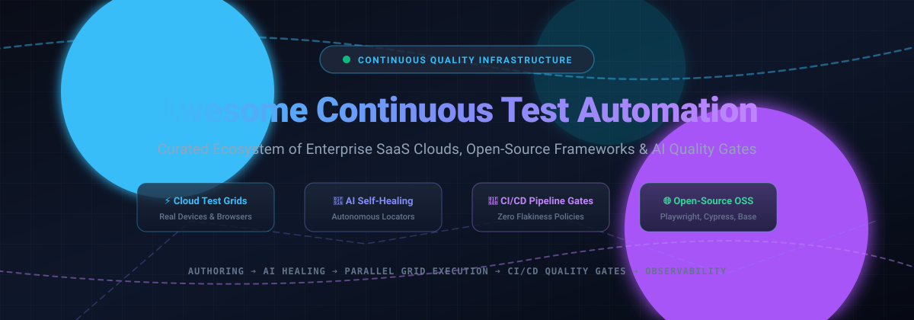

  

# 🚀 Awesome Continuous Test Automation Platform

  
  
  
  
  
  

---

## 🎯 Continuous Test Automation Platform Ecosystem

> **A curated showcase of leading SaaS test clouds, AI-driven self-healing frameworks, open-source test runners, and CI/CD quality gate solutions for modern software delivery.**

Continuous Test Automation Platforms bridge automated authoring, distributed cloud execution grids, self-healing element locators, and automated release verification. By tying end-to-end (E2E) web, mobile, and API test suites directly into CI/CD pipelines, engineering organizations detect regressions earlier, prevent test suite flakiness, and eliminate QA delivery bottlenecks.

---

## 📑 Table of Contents

- [📊 Sector Overview & Market Dynamics](#-sector-overview--market-dynamics)
- [☁️ SaaS & Hosted Platforms](#️-saashosted-platforms)
- [🌐 Open-Source GitHub Projects](#-open-source-github-projects)
- [🤝 How to Contribute](#-how-to-contribute)
- [💖 Support & Sponsorship](#-support--sponsorship)
- [📈 Star History](#-star-history)
- [⚠️ Disclaimer](#️-disclaimer)

---

## 📊 Sector Overview & Market Dynamics

The global continuous testing and automated test execution platform market is estimated at **$2.5B to $3.6B in 2026** and projected to surge beyond **$7.5B by 2030** at an expected Compound Annual Growth Rate (CAGR) of **11.5% to 15.1%**, powered by widespread adoption of AI-native quality gates, shifting testing left/right in DevSecOps pipelines, and cloud-native test grid scaling.

The sector exhibits **moderate fragmentation**: while enterprise giants and private-equity-backed anchors (such as Tricentis, BrowserStack, Sauce Labs, and SmartBear) control major recurring enterprise software contracts, it is **not a winner-take-all market**—rapid innovations in agentic AI test authoring, visual regression tools, and community-driven open-source ecosystems (Playwright, Cypress, SeleniumBase, Testcontainers) maintain a fiercely competitive, multi-vendor landscape.

---

## ☁️ SaaS & Hosted Platforms

*Ranked in descending order by estimated enterprise scale, valuation, and annual revenue.*

| 🏢 Product | 📈 Valuation / Scale (ARR) | 📝 Description | 💳 Pricing (Starting Tier) | 🎁 Free Tier Limit / Free Trial Limit |
|---|---|---|---|---|
| **[Tricentis Tosca & Testim](https://www.tricentis.com/)** | **~$4.5B Valuation** (~$500M ARR) | Enterprise model-based test automation suite spanning web, desktop, SAP, mobile, APIs, and AI self-healing locators (Testim). | Enterprise Tosca starting at **~$20,000/year** (~$1,666/mo contract); Testim starting at **$450/month** | **Free Tier**: Testim Community tier includes 1,000 free web test runs/month. **Free Trial**: 14-day enterprise proof-of-concept trial for Tosca & Testim Pro. |
| **[BrowserStack](https://www.browserstack.com/)** | **~$4.0B Valuation** (~$230M ARR) | Leading cloud test grid with 30,000+ real mobile devices and 3,000+ browsers for Selenium, Playwright, Cypress, and Appium with unlimited test minutes. | Desktop Automate from **$59/month** (Chrome, annual) or **$99/month** (all browsers, 1 parallel); App Automate from **$199/month** | **Free Trial**: 100 minutes of automated web testing, 100 minutes of mobile app testing, up to 5 parallel tests. Lifetime free plan for open-source maintainers (5 parallels / 5 users). |
| **[SmartBear TestComplete](https://smartbear.com/product/testcomplete/)** | **~$1.8B+ Valuation** (~$150M ARR) | Scripted and codeless UI automation suite across desktop, web, and mobile apps with AI-powered visual recognition across 500+ UI controls. | Base license starts at **$3,598/year** (~$300/mo equivalent); TestComplete Pro at **$6,499/year** (~$541/mo equivalent); TestExecute runner at $675/year | **Free Trial**: 14-day to 30-day fully functional node-locked evaluation across desktop, web, and mobile environments without execution limits. |
| **[LambdaTest (TestMu AI)](https://www.lambdatest.com/)** | **~$400M Valuation** (~$100M+ ARR) | Cloud testing grid with AI-native KaneAI test authoring, responsive cross-browser validation, and HyperExecute parallel pipeline acceleration. | Live manual testing from **$15/month**; Web Automation from **$79/month** (annual, 1 parallel); Enterprise plans available | **Free Tier**: 100 lifetime automated testing minutes, 60 min/month live browser testing (up to 2 min/session), 1 parallel session, 2,000 visual testing snapshots/month, and unlimited Test Manager projects. |
| **[mabl](https://www.mabl.com/)** | **~$360M Valuation** (~$25M ARR) | AI-native low-code test platform providing automated self-healing assertions, performance insights, accessibility checks, and native CI/CD quality gates. | Quote-based; entry-level plans start at **$450–$499/month** (includes 500 cloud-run credits/month and unlimited local/CI test runs) | **Free Trial**: 14-day full-featured trial with unrestricted cloud executions, self-healing smart assertions, and CI/CD integration plugins. |
| **[Leapwork](https://www.leapwork.com/)** | **~$300M Valuation** (~$35M ARR) | Enterprise visual no-code automation platform tailored for business users and QA teams automating ERPs, Citrix, web applications, and desktop software. | Annual enterprise subscription starting from **$22,000/year** (~$1,833/mo equivalent), scaled by execution agent capacity | **Free Trial**: Up to 30-day guided enterprise trial via Leapwork-as-a-Service with cloud Controller access and execution agents. |
| **[Sauce Labs](https://saucelabs.com/)** | **~$150M+ Funded** (~$85M ARR) | Enterprise cloud testing platform featuring Virtual Device Clouds, Real Device Clouds, error monitoring with Backtrace, and unified test analytics. | Live testing from **$39/month** (annual); Virtual Device Cloud automation from **$149/month** (annual, 1 parallel); Real Device Cloud from **$199/month** | **Free Trial**: 28-day trial with 60 total minutes of automated & live testing, up to 3 parallel virtual machines, and 50 AI authoring/insights queries. |
| **[Katalon](https://katalon.com/)** | **~$30M Funded** (~$36M ARR) | All-in-one test automation suite covering web, mobile, API, and desktop. Combines low-code Studio authoring with TestOps cloud orchestration. | Katalon Studio IDE: **Free**; Professional plan from **$150/seat/month** ($1,800/seat/year); Enterprise custom plans available | **Free Tier**: Katalon Studio free desktop edition with local test authoring/execution across web, mobile, desktop, and API, capped at 10 test suites per project (no CLI/KRE runtime). Platform has a 30-day trial. |
| **[Functionize](https://www.functionize.com/)** | **~$67M Funded** (~$25M ARR) | Autonomous test automation platform leveraging agentic AI, natural language plain-English test generation, and adaptive self-healing locators. | Starter tier: **$0/month**; Growth plan: **$20/month** (3.2M credits/month); Scale plan: **$100/month** (20M credits/month) | **Free Tier**: Permanent free starter plan with 800,000 credits/month (plus 2,000,000 introductory credits), unlimited manual reviews/reports, and full agentic test creation. |

---

## 🌐 Open-Source GitHub Projects

*Ranked in descending order by GitHub Stars_Count.*

| 📦 Project | ⭐ GitHub_Stars | 📄 Description | 💻 Key Strengths |
|---|---|---|---|
| **[Playwright](https://github.com/microsoft/playwright)** |  | Microsoft's cross-browser, cross-language end-to-end automation framework for modern web apps. | Fast headless execution, automatic waiting, network mocking, multi-tab contexts, and trace viewer. |
| **[Cypress](https://github.com/cypress-io/cypress)** |  | Fast, easy, and reliable frontend testing for anything that runs in a browser. | In-browser time-travel debugging, readable syntax, real-time reloading, and active ecosystem. |
| **[Selenium](https://github.com/SeleniumHQ/selenium)** |  | The W3C-standard foundational browser automation framework across all major languages and browsers. | Universal browser driver standard, massive legacy support, Selenium Grid infrastructure. |
| **[k6](https://github.com/grafana/k6)** |  | Developer-centric load and continuous performance testing tool built with Go and JavaScript. | Minimal resource consumption, CLI-first workflow, and CI/CD quality gate integration. |
| **[Appium](https://github.com/appium/appium)** |  | Open-source ecosystem for cross-platform test automation of native, mobile web, and hybrid apps. | Single API across iOS, Android, macOS, and Windows without requiring app modification. |
| **[MeterSphere](https://github.com/metersphere/metersphere)** |  | Enterprise-grade open-source continuous testing platform covering test management, API, UI, and load testing. | Unified QA dashboard, automated test tracking, built-in AI copilot, and Docker microservice setup. |
| **[SeleniumBase](https://github.com/seleniumbase/SeleniumBase)** |  | All-in-one Python browser automation framework merging Selenium and Playwright with anti-bot CDP mode. | Auto-reconnection, bypass bot detection, smart element waits, and integrated visual assertions. |
| **[TestCafe](https://github.com/DevExpress/testcafe)** |  | Node.js tool to automate end-to-end web testing without WebDriver or external browser plugins. | Zero external browser plugin setup, built-in parallel execution, and stable smart assertions. |
| **[WebdriverIO](https://github.com/webdriverio/webdriverio)** |  | Next-gen browser and mobile automation test framework for Node.js based on WebDriver and Chrome DevTools. | Rich plugin community, supports component testing, mobile native app testing, and cloud grids. |
| **[Karate](https://github.com/karatelabs/karate)** |  | Unified open-source test automation framework combining API testing, mocks, UI testing, and performance testing. | Clean cucumber-like BDD syntax without boilerplate Java code; seamless JSON/XML payload matching. |
| **[Airtest](https://github.com/AirtestProject/Airtest)** |  | Cross-platform UI automation framework for mobile games and desktop applications using image recognition. | Object detection via computer vision, supports Android, iOS, Windows, and Unity/Unreal games. |
| **[Testcontainers](https://github.com/testcontainers/testcontainers-java)** |  | Java library supporting lightweight, throwaway instances of Docker containers for integration test suites. | Spin up real PostgreSQL, Kafka, and Selenium nodes programmatically in automated test cycles. |
| **[REST Assured](https://github.com/rest-assured/rest-assured)** |  | Java DSL designed for simplifying automated verification and integration testing of RESTful APIs. | Fluent Given/When/Then assertions, deep Hamcrest integration, and robust XML/JSON payload parsers. |
| **[Allure Report](https://github.com/allure-framework/allure2)** |  | Multi-language test reporting tool that serves clear graphical reports for CI/CD test runs. | Interactive test step visualization, timeline breakdowns, flakiness categorization, and attachments. |
| **[Testsigma (OSS)](https://github.com/testsigmahq/testsigma)** |  | Open-source low-code test automation platform for web, mobile, and API testing with self-healing elements. | Natural-English test authoring, self-hosted Docker deployments, and community-driven extensions. |

---

## 🛠️ Building a Custom Continuous Quality Stack

For engineering teams looking to avoid recurring per-seat or per-parallel-session SaaS costs, you can assemble a state-of-the-art self-hosted platform:
- 🧪 **E2E Browser Automation**: [Playwright](https://github.com/microsoft/playwright) or [Cypress](https://github.com/cypress-io/cypress)
- 🔌 **API Integration & Mocks**: [Karate](https://github.com/karatelabs/karate) or [REST Assured](https://github.com/rest-assured/rest-assured)
- 🐳 **Integration Infrastructure**: [Testcontainers](https://github.com/testcontainers/testcontainers-java)
- 📈 **Continuous Testing Management & Execution**: [MeterSphere](https://github.com/metersphere/metersphere)
- 📊 **Unified Quality Observability & Reporting**: [Allure Report](https://github.com/allure-framework/allure2)

---

## 🤝 How to Contribute

We welcome contributions to expand this directory! To submit a new tool or framework:

1. 🍴 Fork the repository.
2. ✍️ Edit `README.md` following the existing tabular structure.
3. 🔍 Provide accurate descriptions, starting tier pricing, free tier/trial caps, or GitHub Stars_Badges.
4. 🚀 Submit a Pull Request with a clear summary of your additions.

---

## 💖 Support & Sponsorship

If you find this continuous test automation directory useful for your team or workflow:

- ⭐ **Star this repository** to keep up with the latest updates and help others discover it.
- 🍴 **Fork and share** with your QA, DevOps, and Platform engineering teams.
- ☕ **Buy a coffee & sponsor** continuous maintenance via the [GitHub Sponsor Dashboard](https://github.com/sponsors/ishandutta2007).

Thank you for championing open, resilient, and continuous software quality! 🎉

---

## 📈 Star History

---

## ⚠️ Disclaimer

- This is a **community-curated** reference list — not an endorsement of any particular proprietary vendor.
- Continuous test automation platforms execute arbitrary browser commands and API requests; ensure appropriate sandbox isolation, test database hygiene, and secret masking in your CI/CD pipelines.
- Free tiers and pricing change frequently: always review official vendor pages before making enterprise infrastructure procurement decisions.

---

  <b>Built with ❤️ for QA architects, DevOps platform engineers, and developers building continuous quality gates.</b>

